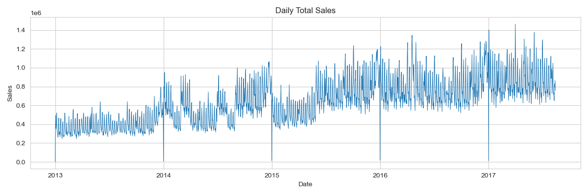
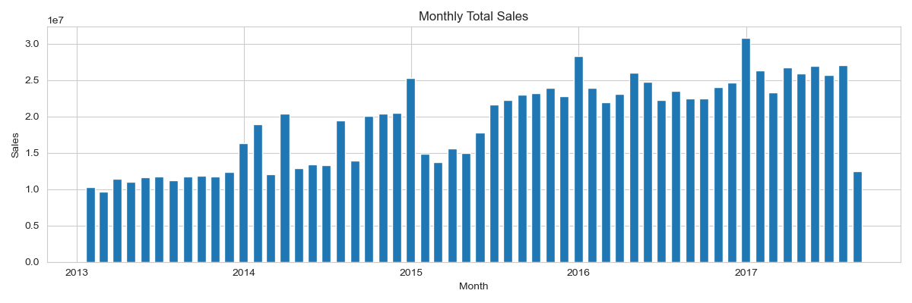
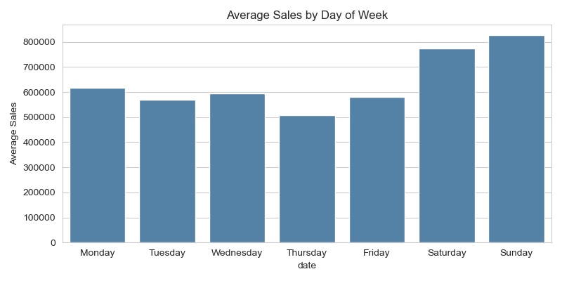
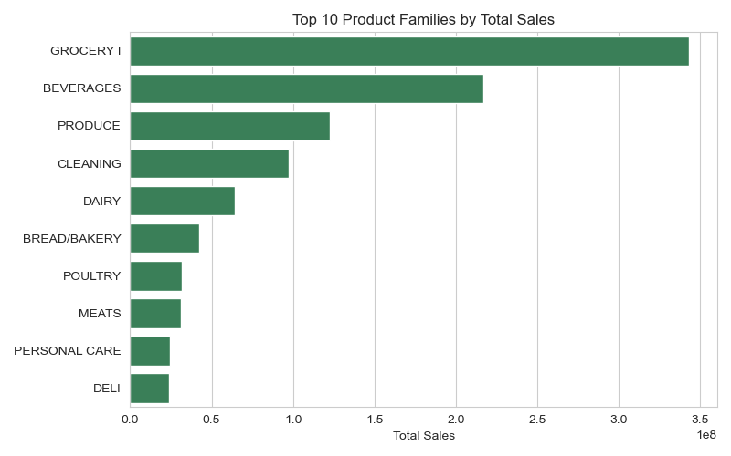
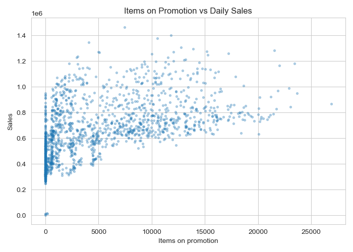
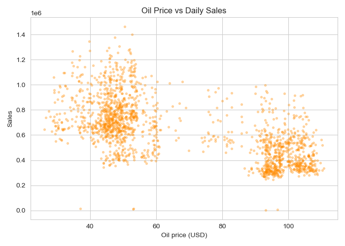
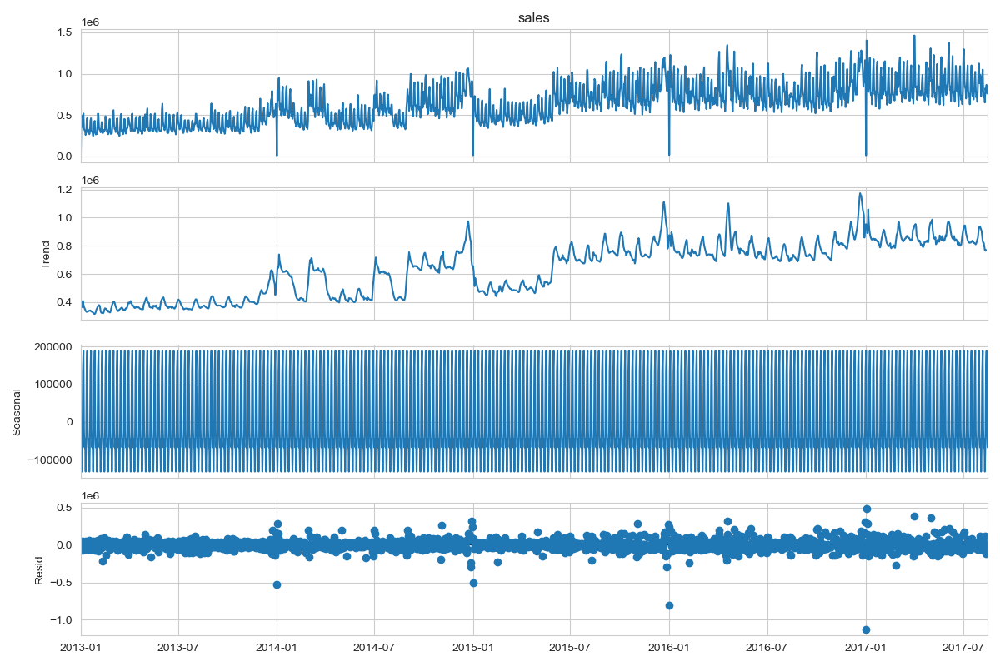
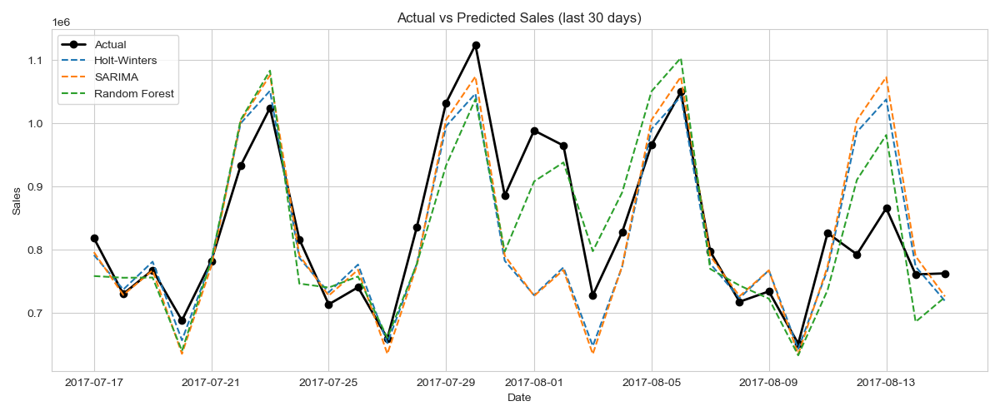

# Retail Sales Analysis and Time Series Forecasting

A college machine learning project that analyses retail sales data from 2013 to 2017 and forecasts future daily sales.

## Objective
Predict the **total number of units sold per day** across all 54 stores and 33 product families of Corporacion Favorita (an Ecuadorian supermarket chain). We hold out the last 30 days as a test set, forecast them with three models, and compare the models using MAE and RMSE.

## Dataset
Kaggle: [Store Sales - Time Series Forecasting](https://www.kaggle.com/competitions/store-sales-time-series-forecasting)

Download these files and place them in the `data/` folder (it is not tracked by git):

| File | Used for |
|---|---|
| `data/train.csv` | daily sales per store and product family (main data) |
| `data/oil.csv` | daily oil price (used in EDA) |
| `data/holidays_events.csv` | holidays and events (loaded and previewed) |

## Folder structure
```
.
├── data/                         # Kaggle CSVs (not in git)
├── notebooks/
│   └── sales_forecasting.ipynb   # full analysis and models
├── results/                      # saved plots
├── .streamlit/config.toml        # app theme
├── app.py                        # Streamlit demo app
├── requirements.txt
└── README.md
```

## Preprocessing
1. Load `train.csv` with parsed dates and check shape, data types, missing values and duplicates.
2. Drop duplicate rows.
3. Aggregate to **daily total sales** (sum of sales over all stores and families for each date).
4. Fill missing dates: 4 days (25 December each year) are missing, so the series is reindexed to a full daily range and filled by linear interpolation.
5. Merge the daily oil price and interpolate its missing values (oil is not traded on weekends and holidays).

## Exploratory Data Analysis

| | |
|---|---|
|  |  |
|  |  |
|  |  |



Key findings:
- Sales have a steady upward trend and a strong weekly pattern; weekends are the busiest days.
- Grocery, beverages and produce make up most of the sales.
- Promotions are positively related to sales (correlation 0.58).
- Oil price is negatively related to sales (correlation -0.63).

## Models
The target (daily sales) is a **continuous number**, so this is a **regression** problem, not classification. Classification would only make sense if we predicted a category, such as "high" vs "low" sales days.

| Model | Type | Details |
|---|---|---|
| **Linear Regression** | Regression | Features: one-hot encoded day of week, month, day, `lag_7`, `rolling_mean_7` |
| **Random Forest** | Regression (tree ensemble) | 200 trees on the same features (day of week as a number) |
| **SARIMA** | Time series | `(1,1,1)x(1,1,1,7)`, trained on the last 1 year for speed |

`lag_7` is the sales 7 days earlier and `rolling_mean_7` is the average of the previous 7 days. Linear Regression and Random Forest use the real recent sales on the test days (one-step-ahead forecast), while SARIMA forecasts all 30 days at once.

## Results (test set = last 30 days)

| Model             | MAE    | RMSE   |
|-------------------|--------|--------|
| Random Forest     | 54,050 | 63,279 |
| Linear Regression | 64,954 | 80,772 |
| SARIMA            | 60,118 | 90,266 |



## Conclusion
- **Random Forest is the best model** on both MAE and RMSE. It learns non-linear patterns and uses the most recent sales through its lag features.
- **Linear Regression** improved a lot after one-hot encoding the day of week (RMSE dropped from 101,264 to 80,772).
- **SARIMA has a lower MAE but a higher RMSE than Linear Regression.** MAE is the average size of the error, while RMSE squares each error before averaging, so it punishes large mistakes more. SARIMA is closer on most days but makes a few big misses, which pushes its RMSE up.
- Possible improvements: add holiday and oil features, tune model parameters, and forecast per store or product family.

## Requirements
Python 3.10+ and the libraries in `requirements.txt`:
pandas, numpy, matplotlib, seaborn, statsmodels, scikit-learn, streamlit, plotly, jupyter.

```bash
pip install -r requirements.txt
```

## How to run

**Notebook**
```bash
jupyter notebook notebooks/sales_forecasting.ipynb
```
Then run all cells (Kernel > Restart & Run All). Plots are saved to `results/`.

**Demo app**
```bash
streamlit run app.py
```
Run it from the project root, then open http://localhost:8501. It has three tabs: Overview, Exploratory Analysis and Forecast. In the Forecast tab you can choose the test period (7 to 60 days) and the models, then compare their predictions and errors.

## Authors
- [sans-creator](https://github.com/sans-creator)
