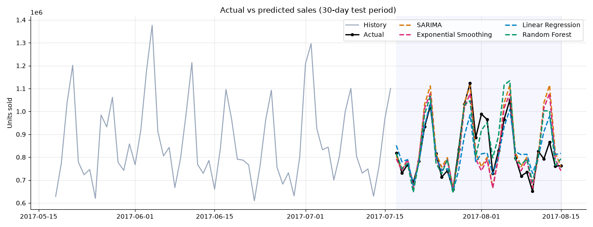

# Retail Sales Analysis and Time Series Forecasting Using Machine Learning

A college machine learning project that analyses five years of retail sales (2013 to 2017) and forecasts
future daily sales with statistical and supervised learning models.

## Objective
Forecast the **total number of units sold per day** across all 54 stores and 33 product families of
Corporación Favorita, an Ecuadorian supermarket chain. Four models are compared fairly on the same 30-day
test period using **MAE** and **RMSE**, and each can produce a real forecast of the days after the data ends.

| Approach | Models |
|---|---|
| Statistical time series | **SARIMA**, **Holt-Winters Exponential Smoothing** |
| Supervised machine learning | **Linear Regression**, **Random Forest Regressor** |

## Dataset
Kaggle: [Store Sales - Time Series Forecasting](https://www.kaggle.com/competitions/store-sales-time-series-forecasting).
Download the files and place them in `data/` (not tracked by git).

| File | Rows | Used for |
|---|---|---|
| `train.csv` | 3,000,888 | daily sales per store and product family (main data and target) |
| `test.csv` | 28,512 | the official future period (16-31 Aug 2017, no sales given); confirms where forecasts start |
| `stores.csv` | 54 | store city, state, type and cluster (store analysis) |
| `oil.csv` | 1,218 | daily oil price (oil analysis) |
| `holidays_events.csv` | 350 | holidays (holiday effect analysis) |
| `transactions.csv` | 83,488 | transactions per store per day (transaction analysis) |

## Project structure
```
.
├── app.py                        # Streamlit dashboard (UI only)
├── src/
│   ├── data.py                   # loading and preprocessing
│   ├── models.py                 # the four models, recursive forecasting, evaluation
│   └── ui.py                     # dashboard styling: CSS, cards, chart theme
├── notebooks/
│   └── sales_forecasting.ipynb   # full analysis, model selection, evaluation, checks
├── results/                      # plots and CSVs written by the notebook
├── data/                         # Kaggle CSVs (not in git)
├── .streamlit/config.toml        # dark theme
└── requirements.txt
```
The app and the notebook import the same `src/` code, so they always give the same numbers.

## Preprocessing decisions
1. **Aggregation.** `train.csv` is summed per day to one series of total units sold (1,688 days).
2. **Christmas.** 25 December is missing in every year because all stores are closed. These days are recorded
   as **0 sales** (closed), not interpolated.
3. **1 January** is also a closure day (only a few stores open, sales about 1-2% of a normal day).
4. **Model input.** For training only, each closure day is replaced by the same weekday one week earlier, so
   one-off shutdowns do not distort the models. The test period has no closure days.
5. **Oil** prices exist only on trading days. Oil analysis joins on those real days only (no filling).
6. **Promotions** are 0 for every row before April 2014 (not recorded), so promotion analysis starts then.
7. **Holidays.** Only national holidays apply to the chain-wide total. Transferred holidays and "Work Day"
   rows are excluded because they are normal working days.
8. **Joins** are validated: `stores` joins one-to-one on `store_nbr`; `transactions` joins on `date` + `store_nbr`.

## Models

| Model | Settings | How it forecasts |
|---|---|---|
| SARIMA | (1,0,1)x(1,1,1,7), last 730 days | fitted time-series model |
| Exponential Smoothing | Holt-Winters, damped additive trend, additive weekly seasonality | fitted time-series model |
| Linear Regression | one-hot weekday and month, day, year, `lag_7`, `lag_14`, `rolling_mean_28` | recursive |
| Random Forest | 300 trees, `min_samples_leaf=2`, same features | recursive |

- **Recursive forecasting**: Linear Regression and Random Forest predict one day at a time, and each prediction
  becomes the lag feature for later days. They never see actual future sales.
- **Model selection**: settings were chosen with rolling validation on six 30-day windows (January to July 2017),
  before the test period. The comparison tables are in the notebook.

## Evaluation
- **Chronological split**: train 1 Jan 2013 to 16 Jul 2017, test 17 Jul to 15 Aug 2017 (last 30 days).
- **Same task for all models**: each forecasts all 30 test days in one go from the same starting point.
- **Metrics**: MAE, RMSE, MAPE and R², computed from the actual predictions. A seasonal naive baseline
  (repeat the last week) is included as a reference.

| Model | MAE | RMSE | MAPE | R² |
|---|---|---|---|---|
| **Random Forest** | **49,569** | **68,483** | **5.9%** | **0.689** |
| Linear Regression | 57,777 | 75,944 | 6.7% | 0.618 |
| Exponential Smoothing | 57,897 | 87,234 | 6.7% | 0.495 |
| *Seasonal naive (baseline)* | *60,672* | *91,696* | *7.0%* | *0.443* |
| SARIMA | 61,381 | 92,511 | 7.2% | 0.433 |

Random Forest is best on every metric in this test period. SARIMA did not beat the simple baseline here.
These values come from `results/model_comparison.csv` (written by the notebook) and are recalculated live in the app.



## Dashboard
Four sections, dark theme:
1. **Overview**: total sales, average daily sales, highest day, top family, sales trend, datasets.
2. **Sales Analytics**: monthly and yearly patterns, weekdays, product families, stores, national holiday effects,
   promotions, oil prices and transactions.
3. **Forecasting**: choose a model and a 7, 14 or 30-day horizon, generate a forecast starting 16 Aug 2017,
   view it as a chart and a table, and download it as CSV.
4. **Model Comparison**: MAE, RMSE, MAPE and R² for all models, actual vs predicted, error by forecast day.

## How to run
Requires Python 3.11 or newer (tested on 3.13).

```bash
python -m venv .venv
.venv\Scripts\activate          # Windows  (macOS/Linux: source .venv/bin/activate)
pip install -r requirements.txt
```

**Dashboard** (from the project root):
```bash
streamlit run app.py
```
Open http://localhost:8501. The first load takes a few seconds while the data is prepared and the models are trained;
after that, results are cached.

**Notebook**:
```bash
jupyter notebook notebooks/sales_forecasting.ipynb
```
Select the kernel of the `.venv` environment, then run all cells (about 1-2 minutes). Plots and CSVs are saved to `results/`.

## Limitations
- One aggregate series: no forecasts per store or product family.
- Holidays, promotions and oil are analysed but not used as model features.
- Some product families have recording gaps in 2014 and early 2015 (e.g. Produce), which remain in the training data.
- The test period is a single 30-day window, so small differences between models should not be over-interpreted.
- Random Forest cannot predict values outside the range seen in training, and recursive errors grow with the horizon.
- Future forecasts (after 15 Aug 2017) cannot be scored because Kaggle does not publish the real sales.

## Authors
- [sans-creator](https://github.com/sans-creator)
